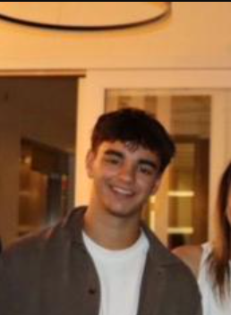

# *TPC3 - Corrida para o 100*

Afonso Fernandes Lopes Alves A115038

### *Resumo*

Até agora este sinto que foi o trabalho mais desafiante. Senti que percebi a lógica do jogo de forma fácil, porém transmitir certas informações para código nem sempre foi fácil. Em certo ponto senti dificuldade em perceber o que eu proprio estava a escrever devido à quantidade exurbitante de código que havia.
Apesar de ter feito grande parte por mim próprio em pequenos detalhes necessitei de LLM's para me ajudar a resolver certos problemas para os quais não encontrava solução. Ainda que não seja o melhor, usa-las fez me perceber o que fiz de errado e entender o porque de aquele código dar certo e ser adequado.

## *Resolução*

[TPC3](TPC3.ipynb)